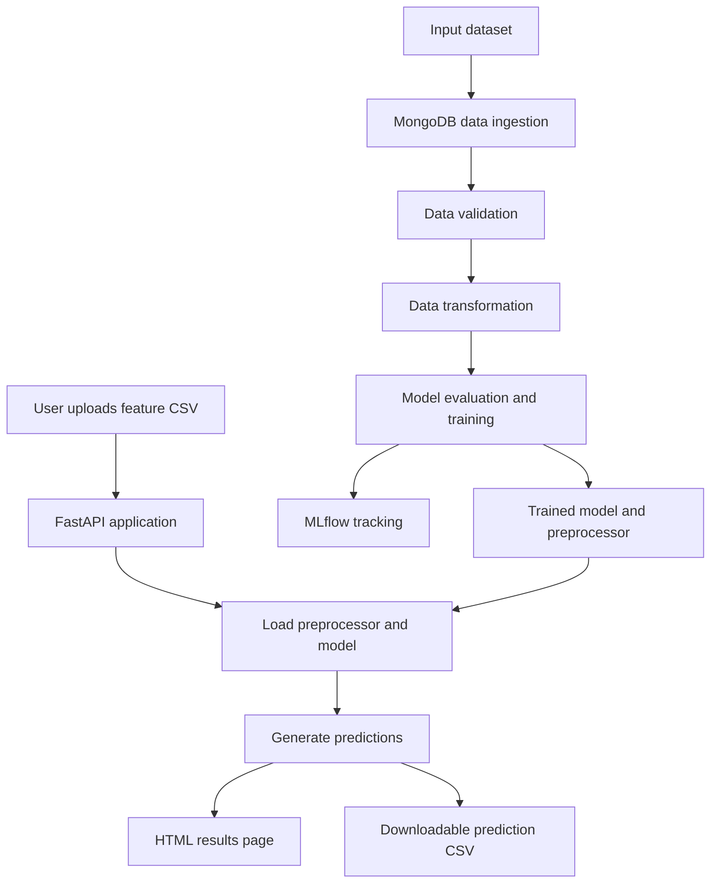

# Network Security – Phishing Website Detection

A machine-learning project that classifies website records as **Phishing** or **Legitimate** using a set of 30 website-related features. The project includes a data-ingestion and model-training pipeline, MLflow experiment tracking, a FastAPI prediction service, and a simple browser-based interface for CSV predictions.

> **Project status:** Local training and CSV prediction workflow tested. The FastAPI homepage, prediction results page, and CSV download were tested locally. A public cloud deployment has not yet been documented.

## Table of Contents

- [Overview](#overview)
- [Key Features](#key-features)
- [System Architecture](#system-architecture)
- [Technology Stack](#technology-stack)
- [Repository Structure](#repository-structure)
- [Dataset and Prediction Labels](#dataset-and-prediction-labels)
- [Local Setup](#local-setup)
- [Configure Environment Variables](#configure-environment-variables)
- [Run the Application](#run-the-application)
- [Make Predictions](#make-predictions)
- [API Endpoints](#api-endpoints)
- [Model Training and Experiment Tracking](#model-training-and-experiment-tracking)
- [Output Format](#output-format)
- [Reproducibility and Limitations](#reproducibility-and-limitations)
- [Security Notes](#security-notes)
- [Attribution](#attribution)

## Overview

Phishing websites imitate legitimate websites to deceive visitors and collect sensitive information. This project uses supervised machine learning to classify website records based on engineered website characteristics.

The application supports two main workflows:

1. **Training workflow:** data is ingested, validated, transformed, and used to evaluate classification models. Training artifacts and experiment information are maintained by the project pipeline and MLflow.
2. **Prediction workflow:** a user uploads a CSV containing the expected 30 input features. The FastAPI application loads the saved preprocessing object and trained model, generates predictions, displays a results table, and provides a downloadable CSV.

This is a feature-based classifier. The current interface accepts a CSV of extracted features; it does **not** fetch a URL, crawl a website, or inspect a live webpage by itself.

## Key Features

- MongoDB-backed data ingestion configuration.
- Data validation and dataset-drift checking in the training pipeline.
- Data transformation and preprocessing.
- Evaluation of multiple classification algorithms, including Random Forest, Decision Tree, Gradient Boosting, Logistic Regression, and AdaBoost.
- MLflow experiment tracking and model registration configuration.
- FastAPI endpoints for training and batch prediction.
- HTML frontend for CSV upload and prediction results.
- Prediction summary with phishing and legitimate counts.
- Downloadable prediction output in CSV format.

## System Architecture



## Technology Stack

| Area | Technologies |
|---|---|
| Programming language | Python |
| API / web framework | FastAPI, Uvicorn |
| Data handling | Pandas, NumPy |
| Machine learning | scikit-learn |
| Experiment tracking | MLflow |
| Database | MongoDB / MongoDB Atlas (configured through environment variables) |
| HTML rendering | Jinja2 templates |
| Serialization | Pickle-based model/preprocessor artifacts |
| Version control | Git and GitHub |
| Containerization | Dockerfile included (container build/run should be verified separately) |

## Repository Structure

```text
Priti-Network-Security/
├── .github/workflows/       # GitHub Actions workflow configuration
├── data_schema/             # Dataset schema definition
├── final_model/             # Saved model and preprocessor
│   ├── model.pkl
│   └── preprocessor.pkl
├── Network_Data/            # Source dataset used by the project
├── networksecurity/         # Training pipeline, components, entities and utilities
│   ├── components/           # Ingestion, validation, transformation, model training
│   ├── constant/             # Pipeline constants
│   ├── entity/               # Configuration and artifact entities
│   ├── exception/            # Custom exception handling
│   ├── logging/              # Logging configuration
│   ├── pipeline/             # Training and batch-prediction pipeline code
│   └── utils/                # Shared utilities and ML helpers
├── prediction_output/       # Example input and generated prediction CSV files
├── templates/               # FastAPI/Jinja2 frontend pages
│   ├── index.html
│   └── table.html
├── valid_data/               # Validation/test sample data
├── app.py                    # FastAPI application
├── main.py                   # Training pipeline entry point
├── push_data.py              # Dataset upload utility
├── prepare_input.py          # Sample prediction CSV preparation utility
├── requirements.txt          # Python dependencies
├── setup.py                  # Package configuration
├── Dockerfile                # Container configuration
├── mlflow.db                 # Local MLflow tracking database
├── .env.example              # Environment-variable template (no real secrets)
├── .gitignore
├── ATTRIBUTION.md             # Dataset/source attribution
└── README.md
```

## Dataset and Prediction Labels

The project uses 30 input features describing website and URL characteristics. The expected feature schema is documented in [`data_schema/schema.yaml`](data_schema/schema.yaml). The original target column is named `Result`.

The transformation component maps the original target value `-1` to `0` and leaves `1` unchanged. The application displays the following labels for model output:

| Model output | Display label |
|---:|---|
| `0` | Phishing |
| `1` | Legitimate |

The model expects the same feature definitions and compatible input types used during training. Use the supplied sample input CSV as a starting point, and do not include the target column in a prediction upload.

See [`ATTRIBUTION.md`](ATTRIBUTION.md) for dataset/source attribution and usage details. Confirm that the dataset license permits redistribution before reusing the dataset outside this repository.

## Local Setup

### Prerequisites

- Python installed on your system.
- Git.
- Access to a MongoDB deployment if you intend to run the data-ingestion or training workflow.
- The repository files, including the saved model and preprocessor under `final_model/`.

### 1. Clone the repository

```bash
git clone https://github.com/PritiKumari13/Priti-Network-Security.git
cd Priti-Network-Security
```

### 2. Create and activate a virtual environment

**Windows Command Prompt:**

```cmd
python -m venv venv
venv\Scripts\activate
```

**macOS / Linux:**

```bash
python -m venv venv
source venv/bin/activate
```

### 3. Install dependencies

```bash
python -m pip install --upgrade pip
pip install -r requirements.txt
```

## Configure Environment Variables

Create a local `.env` file in the project root using `.env.example` as a reference. Set the MongoDB connection string required by the application:

```env
MONGODB_URL_KEY=your_mongodb_connection_string
```

Use your own MongoDB connection string locally. **Never commit `.env` or place credentials in source code, screenshots, issues, or README files.** The `.env` file is excluded through `.gitignore`.

The training code may also use MLflow tracking configuration from environment variables, depending on the tracking setup. Configure those values locally if required by your environment.

## Run the Application

Start the FastAPI application from the project root with the virtual environment activated:

```bash
uvicorn app:app --reload
```

Open the frontend in a browser:

- Homepage: <http://127.0.0.1:8000/>
- Interactive API documentation: <http://127.0.0.1:8000/docs>

Keep the terminal running while using the local application.

## Make Predictions

1. Open <http://127.0.0.1:8000/>.
2. Select a CSV file containing the expected 30 feature columns.
3. Click **Run Prediction**.
4. Review the prediction summary and detailed table.
5. Click **Download Prediction CSV** to download the generated results.

A sample file is available at [`prediction_output/sample_input.csv`](prediction_output/sample_input.csv). The prediction output includes the original input features plus:

- `predicted_column`: numeric model output (`0` or `1`).
- `prediction_label`: readable class (`Phishing` or `Legitimate`).

The API also supports direct CSV upload through the `POST /predict` endpoint.

## API Endpoints

| Method | Endpoint | Purpose |
|---|---|---|
| `GET` | `/` | Displays the CSV upload homepage |
| `GET` | `/train` | Starts the training pipeline |
| `POST` | `/predict` | Accepts a CSV file and returns an HTML prediction-results page |
| `GET` | `/download` | Downloads the latest generated prediction CSV |
| `GET` | `/docs` | Displays interactive FastAPI / Swagger documentation |

## Model Training and Experiment Tracking

The training entry point is `main.py`. The training pipeline is organized into separate components for ingestion, validation, transformation, and model training. The model-training component evaluates several classification algorithms and logs metrics/model information through MLflow.

To run the training pipeline, configure the required environment variables and MongoDB access, then run:

```bash
python main.py
```

The FastAPI training route is also available at `GET /train`.

For an MLflow user interface, use the tracking configuration appropriate to your local setup. If the local tracking database is used, the UI can typically be started with:

```bash
mlflow ui
```

Then visit <http://127.0.0.1:5000/>. The exact tracking URI and backend configuration should match the project's MLflow setup.

> **Model metrics:** Add the final verified test-set accuracy, precision, recall, F1-score, and selected model name here after confirming them from the MLflow run or training logs. No performance values are stated in this README because they have not yet been verified for publication.

## Model Evaluation

### Selected Model

**Random Forest Classifier**

The model was selected using GridSearchCV with stratified 3-fold cross-validation. Macro F1-score was used as the model-selection metric. The held-out test dataset was reserved for final evaluation.

### Training vs Testing Performance

| Metric | Training | Testing |
|---|---:|---:|
| Accuracy | 99.03% | 96.92% |
| Macro Precision | 99.06% | 97.00% |
| Macro Recall | 98.97% | 96.79% |
| Macro F1-score | 99.01% | 96.88% |

### Class-wise Testing Performance

| Metric | Phishing (0) | Legitimate (1) |
|---|---:|---:|
| Precision | 97.63% | 96.38% |
| Recall | 95.46% | 98.11% |
| F1-score | 96.53% | 97.24% |

### Testing Confusion Matrix

Rows represent actual classes and columns represent predicted classes.

| Actual / Predicted | Phishing | Legitimate |
|---|---:|---:|
| Phishing | 946 | 45 |
| Legitimate | 23 | 1197 |

- Total test records: 2,211
- Correct predictions: 2,143
- Missed phishing records: 45
- Legitimate records incorrectly flagged as phishing: 23

### MLflow Experiment Tracking

MLflow was used to record:
- Training and testing evaluation runs
- Overall and class-specific metrics
- Confusion matrix artifacts
- Model registration and versioning

Registered model: `NetworkSecurityModel`

Latest registered version: `4`

### Evaluation Note

These results represent evaluation on the held-out test split of the project dataset. Performance on previously unseen, real-world URLs may differ. The application currently accepts extracted website features through CSV upload rather than raw URLs.


## Output Format

The prediction CSV retains the input feature columns and adds two prediction columns. Example:

| predicted_column | prediction_label |
|---:|---|
| `0` | `Phishing` |
| `1` | `Legitimate` |

These labels describe the model's classification output. They should not be treated as a guarantee that a real website is safe or malicious. Validate the model on representative, independently labelled data before using it for operational security decisions.

## Reproducibility and Limitations

- Prediction input must contain the expected 30 features, with compatible names and data types.
- The current frontend accepts CSV feature data; it does not accept a raw URL for automatic feature extraction.
- Training requires the configured data source and environment variables.
- The repository contains serialized model artifacts. Only load trusted pickle files from this repository; pickle-based files can execute code during deserialization if tampered with.
- Local application testing has been performed. A cloud deployment and public production URL are not included in this project status.
- Re-run evaluation on a separate, representative dataset before making claims about real-world detection performance.

## Security Notes

- Keep `.env` local and never push it to GitHub.
- Keep real MongoDB credentials out of `push_data.py`, `test_mongodb.py`, notebooks, logs, and screenshots.
- If a credential has ever been committed or shared, rotate it; deleting it from the latest version alone does not remove it from Git history.
- Treat uploaded CSV files as untrusted input.
- Only use this project and its predictions for authorized educational, testing, or research purposes.

## Attribution

Please read [`ATTRIBUTION.md`](ATTRIBUTION.md) for dataset credits, source references, and applicable terms. Retain the original dataset attribution when redistributing or modifying the data.

---

**Project repository:** <https://github.com/PritiKumari13/Priti-Network-Security>
